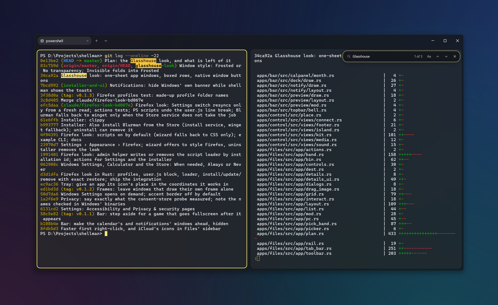
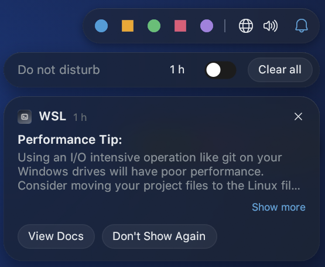
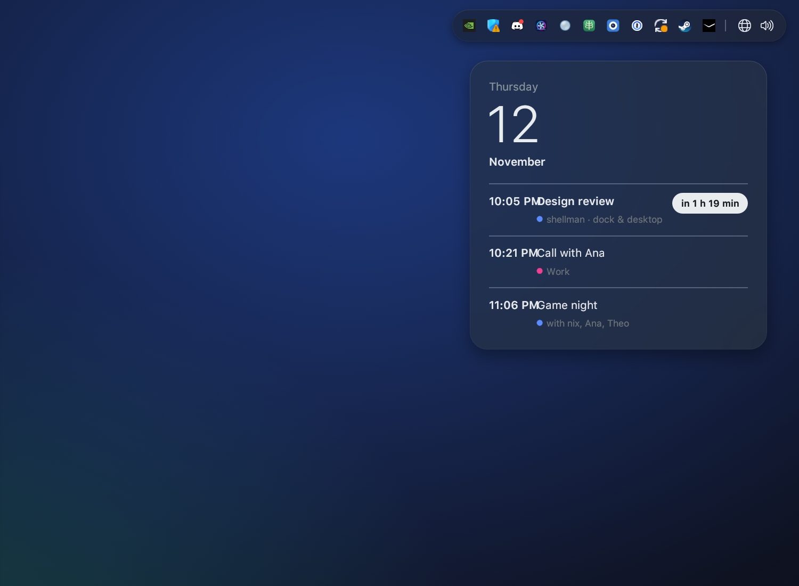

# shellman

I wanted Windows 11 to look and feel the way I want, so I'm replacing the shell. shellman takes
the place of `explorer.exe`: its own top bar, dock, desktop, launcher, Alt+Tab, file manager,
terminal, settings and task manager. Everything is drawn as floating islands of blurred glass in
one accent colour. It's written in Rust.

I use it every day as my real shell. It's still a personal project and a lot is unfinished, so
expect rough edges. What's done, what's not and why things work the way they do is in
[docs/PLAN.md](docs/PLAN.md) (my working notes, long and detailed).

## Screenshots

### Files

Tabs, a sidebar that folds down to icons, tags, and glass context menus.


### Terminal

Tabs, profiles, find, selection and mouse support, on a bundled ConPTY.



### Dock

Live window previews on hover, drag to reorder, drop files onto icons, badges, progress bars and
the Recycle Bin.


### Top bar

A "now" pill with your next event or what's playing, the calendar under the clock, and
notifications under the bell.


| Calendar | Notifications |
|---|---|
|  |  |

### Desktop widgets

Today (calendar and weather) and Now playing, under the tray.



### Settings


## Before you try it

shellman really replaces your shell if you let it. Installing it doesn't do that on its own:
making it the shell is a separate switch, off unless you turn it on. If you do turn it on and
something goes wrong, here's how to get Explorer back:

- Hold **Shift** while you sign in. shellman steps aside and starts Explorer.
- Or press Ctrl+Alt+Del, open Task Manager, Run new task, `explorer.exe`. Then uninstall
  shellman from Settings > Apps, or run `shellman-session.exe --uninstall` from its folder.
- Or from Run new task, `cmd`, then
  `reg delete "HKCU\Software\Microsoft\Windows NT\CurrentVersion\Winlogon" /v Shell /f`
  and sign out and back in.

It only changes things for your own Windows account. Other accounts on the PC keep Explorer.

## Install

There are no downloads yet, so for now you build it yourself (see below). That gives you one
file, `shellman-<version>-setup.exe`. Run it:

- Pick a folder. The default is `%LOCALAPPDATA%\Programs\shellman`, no admin rights needed.
- Three optional switches, all off by default: make shellman your shell from the next sign-in,
  make shellman Terminal the default terminal, and use shellman Files for other apps' Open and
  Save dialogs.
- Click Install.

Running a newer setup over an existing install updates it and keeps your settings.

## Uninstall

Settings > Apps > Installed apps > shellman > Uninstall.

It puts back everything it changed (the shell, the default terminal, the Open and Save dialogs),
closes shellman's apps and removes its files and shortcuts. You can also tell it to remove your
settings. If shellman is the shell running right then, it keeps running until you sign out and
the files go when you sign back in.

## Building

You need Windows 11 and a current Rust toolchain.

```
cargo build --release --workspace
target\release\shellman-installer.exe --pack target\release
```

The setup file ends up in `target\dist`.

While working on it I skip the setup file and use the command-line tool instead:

```
target\release\shellman-setup.exe install --from target\release
target\release\shellman-setup.exe update --from target\release --restart
target\release\shellman-setup.exe uninstall --revert
```

`shellman-setup --help` lists everything it can do.

## What's in here

| Folder | What it is |
|---|---|
| `apps/session` | The shell process Windows starts at sign-in. Starts and watches over everything else |
| `apps/bar` | Top bar, tray, dock, notifications, calendar |
| `apps/desktop`, `apps/shelf` | Wallpaper, the file shelf and the widgets |
| `apps/launcher`, `apps/switcher` | App launcher and Alt+Tab |
| `apps/files`, `apps/pickhook` | File manager, and the hook that gives other apps its Open and Save dialogs |
| `apps/terminal` | Terminal |
| `apps/settings`, `apps/control`, `apps/tasks` | Settings, quick controls, task manager |
| `apps/setup`, `apps/installer` | Install, update and uninstall, and the one-file setup |
| `crates/core`, `crates/ui` | Shared Windows code, and the shared look (glass, colours, controls) |
| `integrations/firefox` | Optional: makes Firefox match |

## Known problems

- With shellman as the shell, Windows didn't start packaged apps' background tasks at sign-in
  (I noticed because Dolby Access stopped working). shellman now tells Windows the sign-in is
  done the way Microsoft's own shells do, but I haven't confirmed it at a real sign-in yet.
- shellman's own apps and panels open slowly after a few idle minutes.

## Licence

Copyright (C) 2026 xnixy. shellman is free software under the GNU General Public License,
version 3 or any later version: see [LICENSE](LICENSE). You can use it, change it and share
it, and if you share a changed version, you share its source under the same licence.

The bundled ConPTY is Microsoft's, under the MIT licence: see
[third_party/conpty](third_party/conpty).
