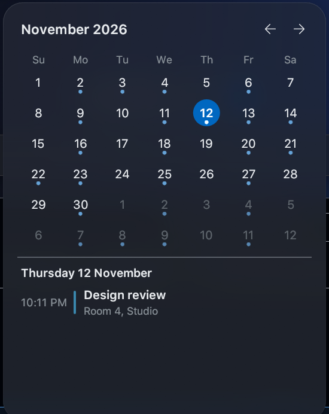
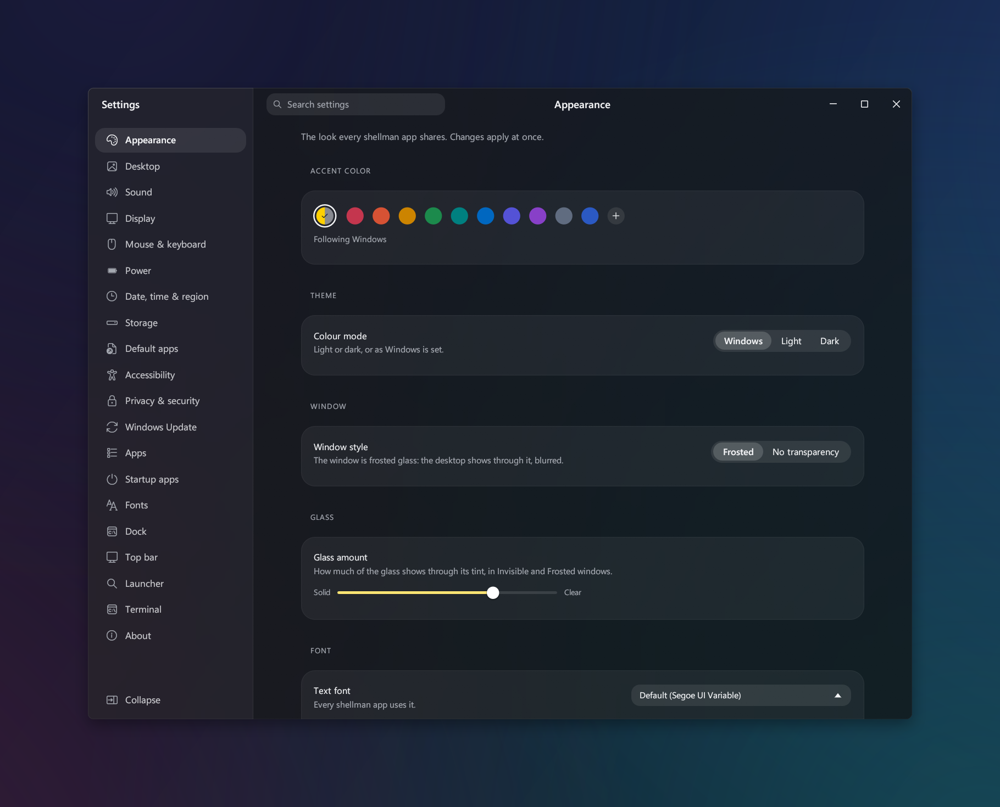

# shellman

A replacement desktop shell for Windows 11, written in Rust. It takes the place of
`explorer.exe` as the shell: its own top bar, dock, desktop, launcher, window switcher, file
manager, terminal, settings and task manager, all drawn as floating islands of blurred glass.

It is a personal project and a work in progress. The plan, the state of every piece and the
known gaps are in [docs/PLAN.md](docs/PLAN.md); the design mockups are in
[docs/design](docs/design).

## Screenshots

### Files

Tabs, a labelled sidebar that folds to icons, tags, and glass context menus.


### Terminal

Tabs, profiles, find, selection and mouse support, on a bundled ConPTY.


### Dock

Live window previews on hover, drag to reorder, drop files onto icons, badges, progress bars
and the Recycle Bin.


### Top bar

A "now" pill for the next event or what is playing, the calendar under the clock, and
notifications under the bell.


| Calendar | Notifications |
|---|---|
|  |  |

### Desktop widgets

Today (calendar and weather) and Now playing, beside the tray.


### Settings



## What is in the repository

| Folder | What it is |
|---|---|
| `apps/session` | The shell process Windows starts at sign-in; starts and supervises the rest |
| `apps/bar` | Top bar, tray, dock, notifications, calendar |
| `apps/desktop`, `apps/shelf` | Wallpaper, the file shelf and the widgets |
| `apps/launcher`, `apps/switcher` | App launcher and Alt+Tab |
| `apps/files`, `apps/pickhook` | File manager, and its hook for other apps' Open and Save dialogs |
| `apps/terminal` | Terminal |
| `apps/settings`, `apps/control`, `apps/tasks` | Settings, quick controls, task manager |
| `apps/setup`, `apps/installer` | The install engine and its command line; the one-exe installer and uninstaller |
| `crates/core`, `crates/ui` | Shared system code, and the glass, rail and menu components |

## Build and install

Windows 11 and a current Rust toolchain.

```
cargo build --release --workspace
target\release\shellman-installer.exe --pack target\release
```

That writes `target\dist\shellman-<version>-setup.exe`, one exe with every file inside. Run it:
a window asks for the folder (default `%LOCALAPPDATA%\Programs\shellman`, no administrator
rights) and offers, all off by default, to make shellman the Windows shell from the next sign-in,
shellman Terminal the default terminal, and shellman Files the Open and Save dialogs of other
apps. Holding Shift at sign-in still starts Explorer. Running a newer one over an install updates
it (and sets those three to match its switches).

To remove it: Settings > Apps > Installed apps > shellman > Uninstall. That puts back the shell,
the default terminal and the dialogs, closes shellman's apps and removes its files, shortcuts
and (when asked) settings. If shellman is the shell running at that moment, it keeps running and
its files go when you sign in again.

The same from a terminal, for the developer loop: `target\release\shellman-setup.exe install
--from target\release` (or `update --restart`), and `shellman-setup uninstall --revert`; see
`shellman-setup --help`.

## Known problems

- With shellman as the shell, Windows does not start packaged apps' background tasks at
  sign-in (found with Dolby Access OEM, which stopped running). Not fixed.
- A dock pin for an app whose window belongs to a helper process (Steam) shows the wrong icon
  or does not start the app after a restart. Unfinished work is on the `wip/dock-pins` branch.
- Opening shellman's own apps and panels is slow after a few idle minutes. Unfinished work is
  on the `wip/open-speed` branch.
